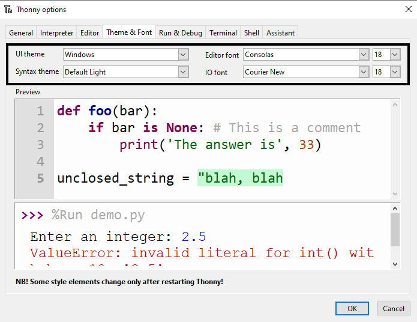

Thonny umožňuje změnit téma a písmo softwaru. Tato funkce znamená, že můžeš zvětšit velikost písma a změnit barvy pozadí a textu podle svých potřeb.

Změna motivu a písma:

+ Klikněte na Nástroje -> Možnosti.
+ Klikněte na záložku „Motiv a písmo“.
+ Klikni na rozbalovací nabídky pro každou možnost, dokud nenajdeš nastavení, které nejlépe vyhovuje tvým potřebám.

+ Po dokončení stiskni OK.

**Varování**: Drž se jednoduchých a čistých fontů. Pokud použíješ písmo ve stylu ručně psaného textu, může to ztížit jeho čtení a ladění.

