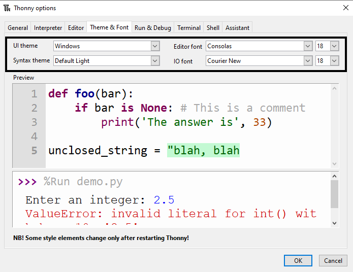

Thonny te permite cambiar el tema y la fuente del programa. Con esta función puedes aumentar el tamaño de la fuente y cambiar los colores del fondo y del texto según tus necesidades.

Para cambiar el tema y la fuente:

+ Haz clic en Herramientas -> Opciones.
+ Haz clic en la pestaña 'Tema & Fuente'.
+ Haz clic en los menús desplegables de cada opción hasta encontrar la configuración que mejor se adapte a tus necesidades.

+ Presiona Aceptar cuando termines.

**Advertencia**: Usa fuentes sencillas y claras. Si usas una fuente que imita la escritura a mano, puede ser más difícil leer el código y corregir errores.

